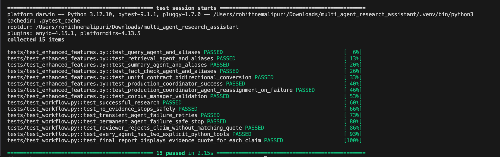
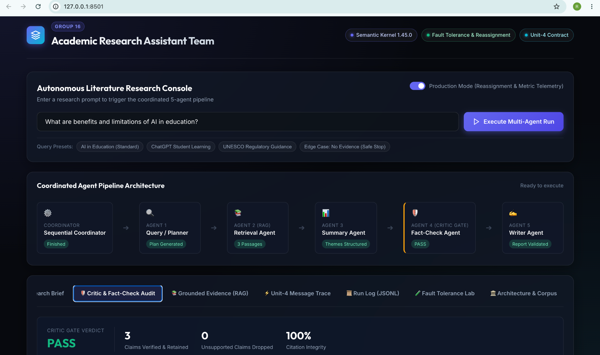
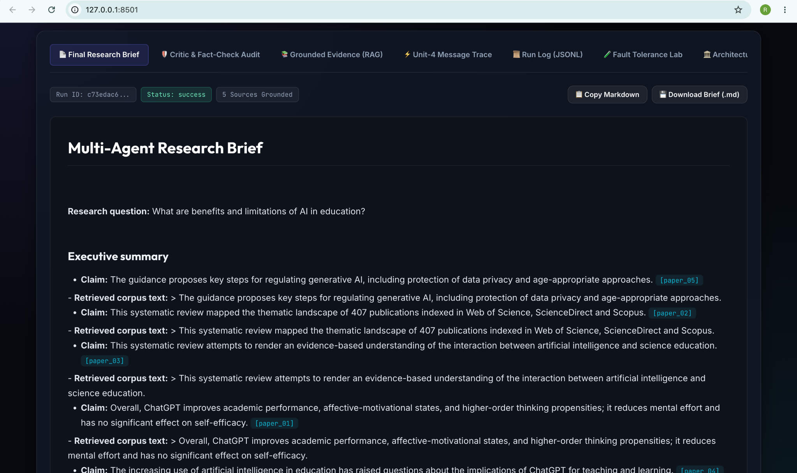
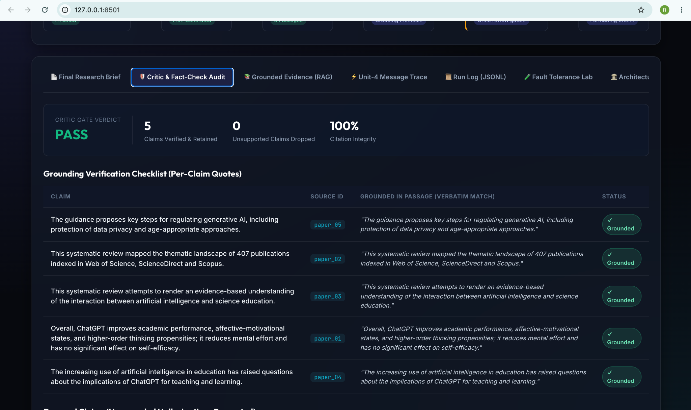
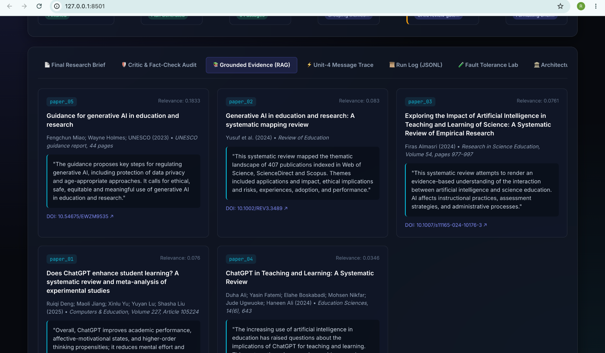
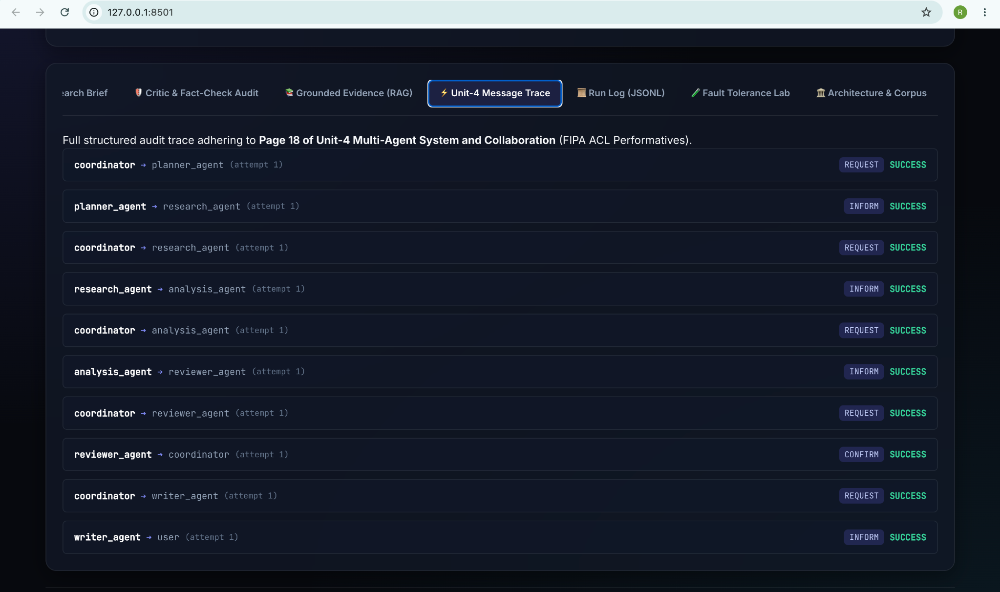
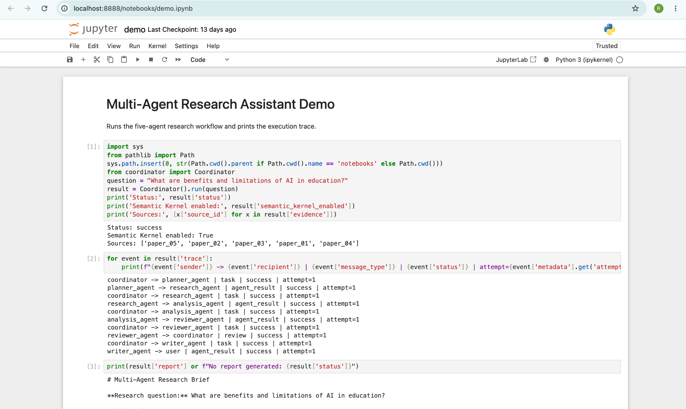
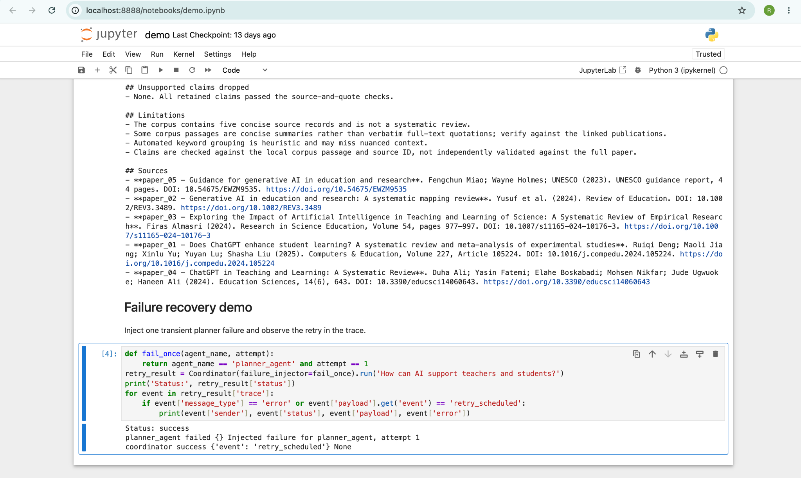

# Multi-Agent Research Assistant

A small, reproducible academic research assistant with five specialist modules, structured messages, local retrieval, review, retry handling, an append-only run log, and tests.

## Requirements

- Python 3.11+
- macOS Terminal
- Internet access for the initial dependency installation only
- No model API key required for the deterministic baseline

## Setup on macOS

```bash
cd multi_agent_research_assistant
python3 -m venv .venv
source .venv/bin/activate
python -m pip install --upgrade pip
pip install -r requirements.txt
```

## Run the demo

```bash
python demo.py
```

Or launch Jupyter:

```bash
jupyter notebook notebooks/demo.ipynb
```

## Run tests

```bash
pytest -q
```

## Agent roster

| Module | Responsibility | Python tools |
|---|---|---|
| `agents/planner_agent.py` | Breaks a question into subquestions | `extract_keywords`, `generate_subquestions` |
| `agents/research_agent.py` | Searches the corpus and retrieves evidence passages | `search_documents`, `retrieve_passages` |
| `agents/analysis_agent.py` | Groups and compares findings | `group_findings_by_theme`, `compare_evidence` |
| `agents/reviewer_agent.py` | Checks evidence support and source references | `verify_citations`, `detect_unsupported_claims` |
| `agents/writer_agent.py` | Writes and validates the report | `format_research_report`, `validate_report_sources` |

The tools are plain Python functions. The `tools/kernel_plugins.py` module exposes them through Semantic Kernel plugins. The coordinator initializes a Semantic Kernel `Kernel` and registers the plugins when the dependency is installed. The workflow uses deterministic Python calls so the baseline demo and tests do not require a paid LLM endpoint.

## Architecture and why it fits

The workflow is a sequential pipeline with a critic/reviewer gate. It suits research because evidence must be retrieved before analysis, analysis must be reviewed before writing, and the final report is checked for valid source references. The reviewer can request a limited repair; the coordinator safely stops if evidence is missing or an agent fails after retries.

## Memory and retrieval

The shared `ResearchState` carries the question, plan, retrieved evidence, analysis, review, report, status, errors, attempt counts, and trace. The local corpus under `corpus/` contains five concise, bibliographically identified excerpts/summaries from open-access reviews and UNESCO guidance about AI in education. TF-IDF ranks relevant documents. These short records are a demonstration corpus, not full-text papers or a complete systematic review; verify the full publications before academic citation.

## Honest failure handled

When a query retrieves no relevant passages, the coordinator sets `stopped_no_evidence`, records the reason, and produces no report. When a temporary agent failure occurs, the coordinator retries and records both the failure and retry event in the JSONL log. The reviewer also checks that each retained claim has a source ID and a verbatim evidence quote; unsupported claims are excluded and listed in the report.

## Structured communication

`communication.py` defines the Pydantic `AgentMessage` contract with run ID, message ID, sender, recipient, task ID, message type, status, payload, error, metadata, and timestamp. If your Unit-4 notes prescribe a specific contract, align these fields to the required page before submission.

## Audit log

Each execution appends JSON records to `logs/run.jsonl`. The log is append-only by application behavior; do not truncate it when preserving a demo trace.

## Scope and limitations

The baseline uses deterministic local Python tools, not an LLM, so it is reproducible and needs no API key. Theme classification uses keyword rules. The corpus records link to real publications and institutional guidance, but contain only concise excerpts/summaries rather than complete papers. Confirm that the instructor accepts these sources or replace/augment them with the provided paper set before submitting. The course's Unit-4 page 18 communication contract was not supplied with the assignment PDF, so compare `communication.py` with that note and adjust any required field names before claiming exact contract compliance.

---

# Project Execution & Verification Evidence

Visual evidence of implementation, execution, testing, agent coordination, and validation.

## 1. Automated Test Results

All 15 automated tests passed.



## 2. Streamlit Application and Agent Pipeline



## 3. Final Research Brief



## 4. Critic and Fact-Check Validation



## 5. RAG-Based Evidence Retrieval



## 6. Multi-Agent Communication



## 7. Jupyter Notebook Demonstration



## 8. Failure Recovery and Retry Validation



## Project Validation Summary

| Validation Area | Result |
|---|---|
| Automated Tests | 15/15 Passed |
| Multi-Agent Workflow | Successfully Executed |
| Research Report | Generated |
| Critic / Fact-Check | PASS |
| Citation Integrity | 100% (as shown in audit) |
| Agent Communication | Demonstrated |
| Failure Recovery | Demonstrated |
| Visual Documentation | 8 Screenshots |

**Project Status:** Successfully Implemented, Executed, and Validated.
